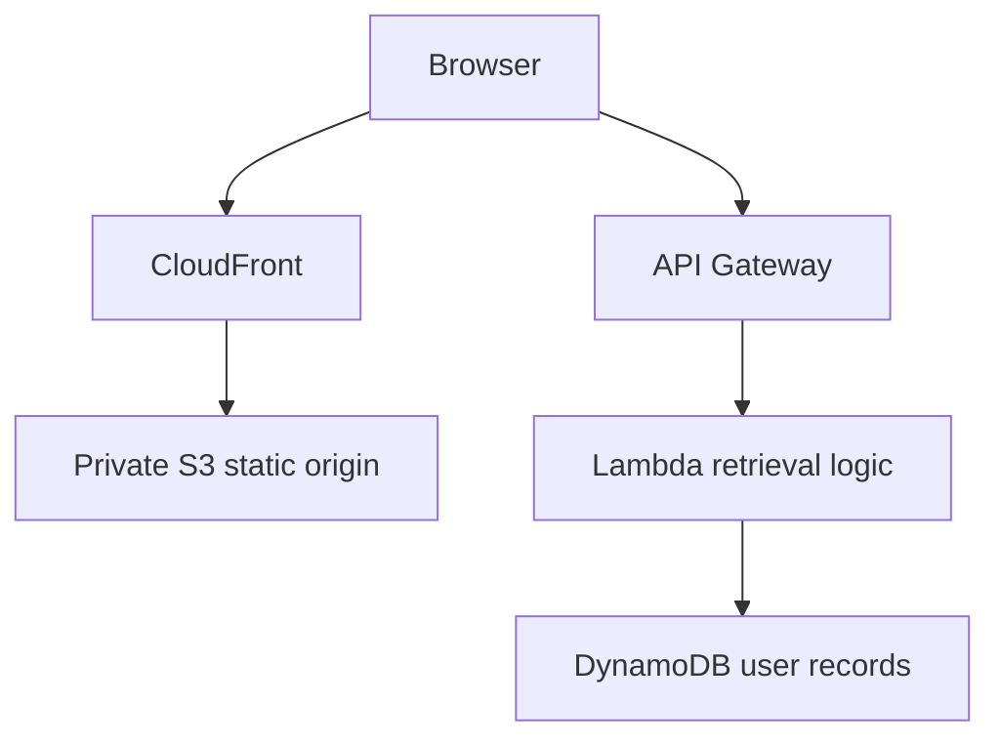
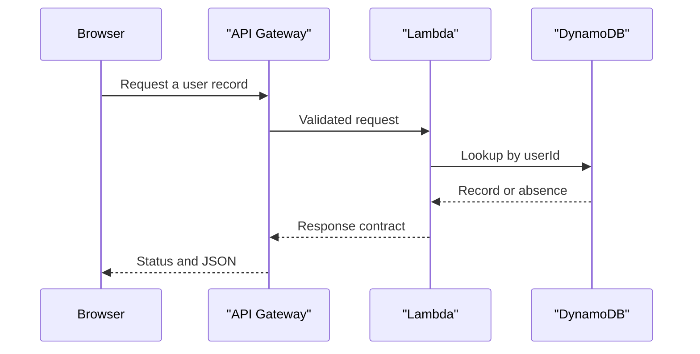

# Three-tier AWS lab: architecture and operational design

Reviewed 11 November 2026 against main `5272094d12a9e8169e42e29a56864321d720ac5f`. Maintenance documentation is AI-assisted. This guided learning case study includes an image, four PDFs and evidence notes. It contains no frontend source, Lambda handler, API contract, infrastructure as code or executable tests. The diagrams below represent the documented exercise, not a verified current deployment.

## Documented topology

Presentation and API calls have different cache, identity and failure boundaries. The original notes discuss Origin Access Control for S3, CORS, Lambda IAM and a `userId` partition key. Their presence in a write-up does not verify current policy or deployment state.

Request validation and response contracts in this sequence are requirements for a future implementation; no handler source is provided here.

## Decisions needed before implementation

An authenticated caller's identity must be bound to allowed records before a lookup. CORS only controls browser access behaviour and does not authenticate callers. Keep S3 access restricted to the intended origin path, apply least-privilege IAM to the handler, validate identifiers and separate missing records from dependency errors. Avoid exposing stack traces or returning user data in public cache entries. Retain correlation identifiers without logging personal records.

Write a versioned API contract and synthetic test fixtures first. Test invalid identifiers, unknown users, unauthorised cross-user access, database timeouts and malformed responses. A deployment smoke test should request both a frontend asset and the API, then confirm the origin cannot be accessed through an unintended public path. No such test has been executed for this repository.

## Scalability and recovery plan

Frontend distribution, function concurrency and database access patterns must be measured independently. Set explicit timeouts, concurrency/admission limits and alarms based on observed demand; do not assume managed services provide unlimited capacity. Cache only appropriate public responses with defined expiry/invalidation. For DynamoDB, choose the partition access pattern against realistic synthetic keys and test concentration on popular keys before claiming even distribution.

Future writes need idempotency and conditional-update decisions. Future pagination needs bounded page sizes and continuation tokens. Preserve deployable versioned artifacts, an infrastructure diff, rollback instructions and recovery checks. Measure latency/error rates and throttling before increasing limits. No benchmark, availability target, backup restoration test or cost estimate is established here.

## Maintenance entry points

Use the [README](../README.md), [original diagram](../AWS%20three%20tier.png) and [evidence notes](PORTFOLIO_EVIDENCE.md). The four linked PDFs are historical lab artifacts. Confirm current AWS configuration requirements before reproducing, and review any provisioning separately. This maintenance does not create, inspect, deploy or charge AWS resources.

